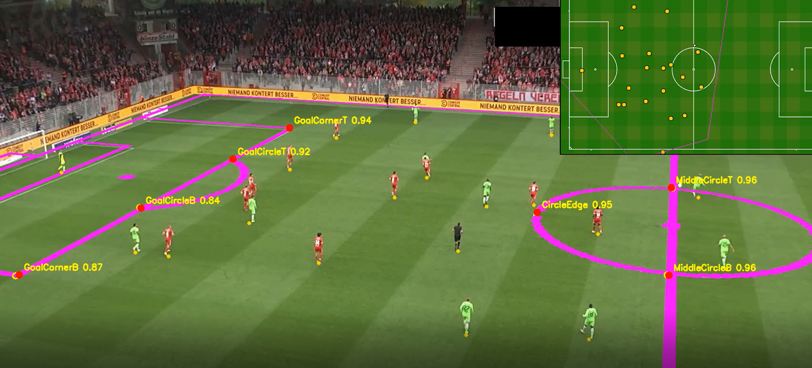
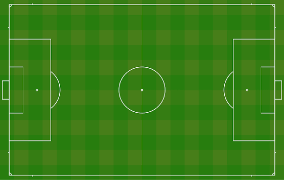

# Pitch keypoints and homography

This document covers how we map the broadcast video `video/121364_0.mp4` onto a 2D
soccer pitch. A YOLO pose model finds pitch landmarks in every frame. A homography
fitted from those landmarks then converts image pixels into pitch metres, so every
player/ball detection can be drawn on the top-down map in `scripts/images.png`.

The final pipeline locates the keypoints with a median error of about **5 px** on
1920x1080 frames. Every one of the 750 frames gets a homography, the average error is
about **0.3 m** on the pitch, and frame-to-frame twitching is kept below **0.2 m**. Getting
there took three iterations; they are described below because the reasons behind each
change are useful for future work.

## Contents

1. [Overview of the pipeline](#overview-of-the-pipeline)
2. [Data](#data)
3. [Keypoints and the 2D map](#keypoints-and-the-2d-map)
4. [Version 1: one pitch object with 7 keypoints](#version-1-one-pitch-object-with-7-keypoints)
5. [Version 2: one class per landmark](#version-2-one-class-per-landmark)
6. [Making the homography robust](#making-the-homography-robust)
7. [Temporal smoothing](#temporal-smoothing)
8. [YOLO26 vs YOLO11](#yolo26-vs-yolo11)
9. [Video processing and rendering](#video-processing-and-rendering)
10. [How to run](#how-to-run)
11. [Limitations and next steps](#limitations-and-next-steps)

## Overview of the pipeline

| Step | Script | What it does |
|---|---|---|
| 1 | `scripts/prepare_pitch_pose_dataset.py` | Converts the Roboflow COCO keypoint export (1920x1080) into a YOLO pose dataset |
| 2 | `scripts/train_pitch_pose.py` | Fine-tunes `yolo11n-pose` and copies the best weights to `model/pitch_keypoints.pt` |
| 3 | `scripts/pitch_homography_video.py` | Predicts keypoints, estimates camera motion, smooths, fits homographies and renders the video and CSVs |
| – | `scripts/pitch_keypoints.py` | Shared definitions: keypoint names, their positions on the pitch in metres, and the metres-to-map conversion |

Player and ball positions come from the existing detection run
(`runs/yolo-video/121364_0_detections.csv`, created by `scripts/yolo_video_experiment.py`).
The homography pipeline does not detect players itself. It only projects those
detections onto the map.

## Data

The annotations are in `data/coco homography data/train/_annotations.coco.json`
(Roboflow export, COCO keypoint format):

- **31 images** at the video's native **1920x1080** resolution, one `pitch` object per image
  with **7 keypoints** each.
- The images are frames `0000`–`0030` of the 30-second, 25 fps video, i.e. **one frame per
  second**.

The dataset script copies these images unchanged and only converts the labels into YOLO
format (see [Version 2](#version-2-one-class-per-landmark)), so the model trains on exactly
what it sees at inference time. Any Roboflow export works, as long as it is in COCO format
and has no resizing or augmentation, including frames from other videos.

**Why COCO and a conversion step?** Roboflow's YOLOv8 / YOLOv5 exports would only give
the annotations as drawn: one full-frame `pitch` object with 7 keypoints, i.e. the
[version 1](#version-1-one-pitch-object-with-7-keypoints) layout. The label conversion
to one class per landmark is needed either way. COCO is the better input for it: it keeps
the keypoint names (checked against the expected order) and the original file names (used
for sorting and the split), all in one JSON file.

**Split:** sorted by original file name, every 5th frame (`0005`, `0010`, … `0030`) goes to
validation, giving **25 train / 6 val** images (34 validation keypoints). Since neighbouring
frames of one video are very similar, the validation score is optimistic about other videos
(see [Limitations](#limitations-and-next-steps)).

## Keypoints and the 2D map

| # | Name | Meaning |
|---|---|---|
| 0 | `GoalCornerB` | Penalty box front line, bottom corner |
| 1 | `GoalCircleB` | Penalty arc meets box line, bottom |
| 2 | `GoalCircleT` | Penalty arc meets box line, top |
| 3 | `GoalCornerT` | Penalty box front line, top corner |
| 4 | `MiddleCircleT` | Centre circle meets halfway line, top |
| 5 | `MiddleCircleB` | Centre circle meets halfway line, bottom |
| 6 | `CircleEdge` | Left-most point of the centre circle |



Note that keypoints 0–3 all lie on one straight line (x = 16.5 m), as do 4 and 5. A
homography needs at least 4 points with no 3 of them on a line, so frames that show
only the penalty box line cannot be solved from keypoints alone. This shapes much of
the design below.

**Map image:** `scripts/images.png` (561x356 px) is used as the 2D map. Its white pitch
outline was measured at x = 18–542 px and y = 9–346 px, which gives a simple scale + offset
from metres to map pixels (`pitch_m_to_map_matrix`). The final transform for drawing is
`map ← pitch metres ← image pixels`.



## Version 1: one pitch object with 7 keypoints

The first model followed the Roboflow export directly: **one `pitch` object per image whose
bounding box covers the whole frame, carrying all 7 keypoints**.

- Model: `yolo11n-pose.pt`, image size 640, 150 epochs, CPU (about 5 s/epoch) (12 minutes).
- Augmentation: Roboflow adds none. YOLO applies mild random augmentation during training:
  rotation ±3°, translation ±15%, scale ±30%, slight perspective, and colour (hue/saturation/
  brightness) jitter. Flips are **disabled** (a horizontal flip would turn the left penalty box
  into a right one, which has no labels), and so is mosaic.

**On paper it looked great:** validation pose mAP50-95 = **0.92**.

**In practice it was poor.** Measuring the actual pixel distance between predicted and
annotated keypoints showed typical errors of **50–150 px**, with some points over 500 px off.

**Why the metric was misleading:** pose mAP uses OKS (object keypoint similarity), which
scales the allowed error by the *object's area*. A full-frame object is huge, so a 100 px
miss still counts as a "good" keypoint. The lesson: **for homography, judge the model by
pixel error, not pose mAP.**

## Version 2: one class per landmark

The fix was to rethink how the problem is labelled:

- **Each landmark is its own class** with an 80x80 px box centred on it and **a single
  keypoint** (`kpt_shape: [1, 3]`, 7 class names).
- Now the detector's anchor sits right next to the keypoint, and YOLO's class prediction
  tells us *which* landmark it is. At inference, the most confident detection per class is
  used.
- Image size raised to **960** for finer localisation (about 15 s/epoch, roughly 35 min
  on CPU for 150 epochs).

### Why the change helps

In version 1, YOLO had to find one enormous box and predict seven points scattered across
the whole field. The pose loss scales a point's error by the area of its object's box.
Because that box covered the entire image, even a substantial pixel error was small
relative to the box, so training had little incentive to make every point precise. The
same large area also makes OKS-based pose mAP forgiving.

In version 2, each detection is a small box around one landmark, and its class says which
landmark it is. YOLO first learns to locate each landmark separately, then predicts one
nearby point for that detection. The same pixel error is now large relative to the small
box, so the pose loss pushes much harder for accurate placement. Missing or misidentifying
one point is also easier to detect and reject without losing the other six.

This is the main structural improvement, but it is not the only change: image size also
increased from 640 to 960, which can help localisation. Since both changed together, we
cannot attribute the entire measured gain to the label layout alone.

Results on the same validation frames:

| | Version 1 | Version 2 |
|---|---|---|
| Median keypoint error (val) | ~50–150 px | **5.5 px** |
| Max keypoint error (val) | > 500 px | **14 px** |
| Keypoints found (val) | – | **34 / 34** |
| Frames without homography | 37 | **0** |

On the training frames, version 2 found all 148 keypoints with 1 false positive, and the
median error was 4.7 px. Running it on frames decoded straight from the video (what the
pipeline actually uses) gives the same numbers: 5.1 px median on validation. This is the
model in use: `model/pitch_keypoints.pt`.

## Making the homography robust

The homography turns image positions into positions on the pitch. It needs at least four
keypoints spread out across the image. If there are too few, or they all lie on one line,
they cannot determine the mapping by themselves. This happens in the last 130 ish frames.

The script handles this by combining two sources:

- **Landmarks:** when enough reliable points are visible, their known pitch positions give
  the video-to-pitch mapping. If one point disagrees strongly with the others, the script
  drops the worst point and tries again.
- **Camera movement:** OpenCV tracks image details from one frame to the next. The movement
  estimate carries the previous frame's mapping forward as a prediction. Visible landmarks
  then correct that prediction; even when they lie on one line, they can still correct the
  mapping in the direction they show.

If a landmark is far from the prediction when the other landmarks cannot verify it, the
script ignores it rather than letting one bad detection shift the map. This way, it uses
the landmarks when they are useful and relies more on camera movement when they are not.

**Smoothing is another important part of making the result reliable.** A one-frame error in
the detected points or mapping can make the overlay twitch. The script compares neighbouring
frames, compensates for camera movement, and smooths both the keypoints and the homography.
See [Temporal smoothing](#temporal-smoothing) for the details and measured effect.

The final run produced a homography for every frame: 620 used landmarks together with camera
movement, 129 used the movement estimate anchored by partial/collinear landmarks, and the
first frame used landmarks alone.

## Temporal smoothing

The version 2 model is accurate on average, but occasionally a keypoint jumps by a decent
amount for a single frame, making the overlay twitch. Since we process a recorded video
rather than a live stream, the smoothing can use **future frames as well as past ones**,
so it adds no lag.

How the video script applies smoothing:

1. **Pass 1:** predict keypoints and estimate camera motion for every frame.
2. **Keypoint median** (`--keypoint-smooth-radius`, default 3). For each keypoint in frame t,
   its detections in frames t−3 … t+3 are moved into frame t using the chained camera motion,
   and the **median** is taken. A one-frame jump is outvoted by its neighbours. A keypoint
   must be detected in at least half of the window to be used, which also removes one-off
   false detections. The window never crosses a frame where camera motion failed.
3. Fit homographies as described above.
4. **Homography smoothing** (`--homography-smooth-radius`, default 2). For frame t, a grid of
   image points is moved into each neighbouring frame, projected to the pitch with that
   frame's homography, and the Gaussian-weighted average pitch positions are refitted.
5. **Pass 2:** render the video and write the CSVs.

To measure twitching, we compare each frame's homography with the previous frame's
homography moved forward by the measured camera motion. Any difference in movement the
camera doesn't explain:

| Jitter (m) | mean | p95 | p99 | max | frames > 0.5 m |
|---|---|---|---|---|---|
| Before smoothing | 0.124 | 0.243 | 0.325 | **0.408** | 0 |
| After smoothing | 0.060 | 0.103 | 0.139 | **0.189** | 0 |

Smoothing halves the jitter and removes the spikes. It matters even more for a less precise
model: an earlier training run had single-frame spikes of up to 3.1 m, which smoothing
brought down to 0.28 m.

Smoothing did not cost accuracy. Against the 31 hand-annotated frames, the mean error on
the pitch went from 0.34 m to 0.31 m. In the output video, **hollow yellow circles** are raw
detections and **filled red dots** are smoothed keypoints, so you can see twitches being
rejected.

## YOLO26 vs YOLO11

We also trained `yolo26n-pose` with the same labels and settings and compared it on the
validation frames:

| | YOLO11n (used) | YOLO26n |
|---|---|---|
| Keypoints found (conf ≥ 0.4) | **34 / 34** | 17 / 34 |
| Keypoints found (conf ≥ 0.05) | 34 / 34 | 29 / 34 (more wrong ones) |
| Median error when found | **5.5 px** | 6.5 px |
| Max error | **14 px** | 168–456 px |
| Validation box mAP50 | **0.995** | 0.68 |
| CPU inference per frame | **~55 ms** | ~115 ms |

With only 25 training images, YOLO26 learns much more slowly, misses many landmarks, and
sometimes confuses them. That last failure is the worst one for homography. Even its
precision on the keypoints it does find is no better than YOLO11's. **YOLO11n stays the model
in use.** With substantially more annotated frames, YOLO26 may be worth retrying.
Its weights are kept at `runs/pitch-pose/yolo26_best.pt`.

## Video processing and rendering

Everything after the keypoint model is done with **OpenCV** in
`scripts/pitch_homography_video.py`. The video is read twice with `cv2.VideoCapture`:

**Pass 1: measure.** For every frame:

- The pose model predicts the landmarks. Only the most confident detection per class is kept.
- **Camera motion** to the previous frame is estimated at half resolution:
  `cv2.goodFeaturesToTrack` picks up to 600 corner features in the previous frame,
  `cv2.calcOpticalFlowPyrLK` tracks them into the current frame, and `cv2.findHomography`
  with RANSAC (2 px threshold) turns the tracked pairs into a 3x3 frame-to-frame homography.
  RANSAC ignores features on moving players, so the result describes the camera
  (pan/tilt/zoom) only. If fewer than 8 features can be tracked, that step is marked as failed,
  and the smoothing windows never reach across it.

Between the passes, the stored keypoints and camera steps go through the
[smoothing](#temporal-smoothing) and [homography fitting](#making-the-homography-robust)
described above. Only small arrays are kept, not the frames themselves, so memory use stays low.

**Pass 2: project and draw.** Each frame is read again and annotated:

- **Player/ball projection.** The detections from `runs/yolo-video/121364_0_detections.csv`
  are matched by frame number. The **bottom-centre of each box** (the feet) is projected with
  `cv2.perspectiveTransform`, using the image→pitch homography for metres and the
  image→map homography (`pitch_to_map @ image_to_pitch`) for minimap pixels. Only `person` and
  `sports ball` are kept, and anything more than 3 m outside the pitch (spectators, staff) is
  dropped.
- **Pitch-line overlay.** The white lines of `scripts/images.png` are turned into a mask,
  warped into the camera view with `cv2.warpPerspective` using the inverse (map→image)
  homography, and painted **magenta**. If the homography is right, the magenta lines sit
  exactly on the real pitch lines. This makes it the quickest visual check of the whole pipeline.
- **Keypoints.** Raw detections are drawn as hollow yellow circles, and smoothed keypoints as
  filled red dots labelled with name and confidence.
- **Minimap.** A copy of the map image is placed in the top-right corner with player dots
  (yellow-orange), the ball (white) and the camera's **field of view**, which is the four
  frame corners projected onto the map.
- **Status line.** Bottom-left: frame number and where the homography came from
  (`keypoints`, `keypoints+motion`, `partial-keypoints+motion`, `motion`, `none`).

Frames are written with `cv2.VideoWriter` (`mp4v` codec, same resolution and frame rate as
the input). The same pass writes the pitch-positions and homographies CSVs, so the video
and the data always come from the same homographies.

## How to run

```powershell
python -m pip install -r requirements-yolo.txt
python scripts\prepare_pitch_pose_dataset.py     # dataset -> runs/pitch-pose/dataset
python scripts\train_pitch_pose.py               # weights -> model/pitch_keypoints.pt
python scripts\pitch_homography_video.py video\121364_0.mp4
```

Outputs in `runs/yolo-video/`:

- `121364_0_homography.mp4`: pitch lines projected onto the video (magenta), keypoints,
  player/ball dots, and a minimap with player positions and the camera's field of view.
- `121364_0_pitch_positions.csv`: per detection: frame, class, confidence, image foot
  point, **pitch position in metres**, and map pixel position. Detections more than 3 m
  outside the pitch are dropped.
- `121364_0_homographies.csv`: per frame: source/status, keypoints used, mean
  reprojection error (m) and the 3x3 image→pitch matrix (`h00` … `h22`).

Useful options for `pitch_homography_video.py`: `--kpt-conf` (default 0.4),
`--keypoint-smooth-radius`, `--homography-smooth-radius` (0 disables either),
`--keypoint-weight`, `--gate-m`, `--max-frames` for quick tests. `train_pitch_pose.py`
accepts `--model`, `--epochs`, `--imgsz` and `--device` (e.g. `0` for a GPU).

Note: `model/pitch_keypoints.pt` matches the `*.pt` rule in `.gitignore`, so it must be
added with `git add -f` to be committed.

## Limitations and next steps

- **One video, 31 frames.** The model has only seen this clip and camera angle. Expect it
  to fail on other matches or on the right half of the pitch until more varied frames are
  annotated.
- **Error budget.** About 5 px keypoint error currently translates to roughly 0.3 m on the
  pitch. More training frames, a larger model (`yolo11s-pose`), or a higher `--imgsz` are the
  most direct ways to reduce it.
