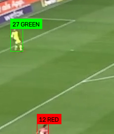
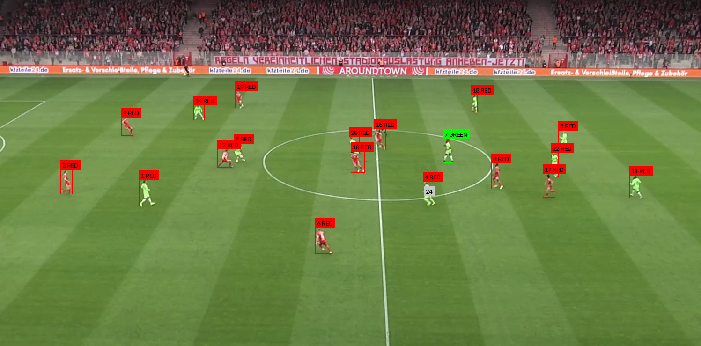
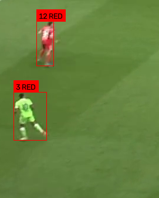
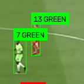
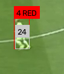

# Football Vision Tracking, Team Classification and Goalkeeper Recognition

## 1. Introduction

This part of the project focuses on building a robust football-video analysis pipeline that can detect and track players, assign stable IDs, classify the two teams by jersey color, recognize the referee and goalkeeper, and display the soccer ball.

The final system combines:

- a fine-tuned YOLO model for player and ball detection;
- BoT-SORT as the underlying temporal tracker for the YOLO player detections;
- a custom stable-ID layer, which decides the final identity (BoT-SORT IDs are not used as identities);
- predicted position and velocity;
- HSV appearance histograms;
- Hungarian global matching;
- K-Means jersey-color clustering;
- separate referee recognition;
- a separate goalkeeper-role classifier;
- separate ball detection.

The final pipeline was reached through several iterations. A number of approaches initially looked reasonable but produced clear errors on the real match footage. These failures became an important part of the error analysis.

## Extra Mile Requirements Mapping

| Assignment extension | Selected option | Implementation |
|---|---|---|
| Tracking & Trajectories | BoT-SORT | Ultralytics BoT-SORT (`scripts/custom_botsort.yaml`) + custom stable-ID reconciliation using predicted position, HSV appearance and Hungarian matching |
| Tactical Analytics | Dynamic team color clustering | Jersey crops, HSV grass filtering, K-Means color extraction and two-team K-Means clustering |

Clarifications:

- The assignment offers "ByteTrack/BoT-SORT **or** ball trajectory smoothing (Kalman filters)". We chose the **BoT-SORT option**, so Kalman-smoothed ball trajectories were not required and are not implemented. The ball is detected per frame and drawn, without being tracked.
- The two-team K-Means cluster centers are learned from the current video rather than being manually predefined. HSV rules are additionally used for filtering, interpreting color evidence, referee recognition and goalkeeper recognition. The team model is fitted once, as soon as enough players have enough clean jersey samples, and is not refitted every frame.
- The **referee** and the **goalkeeper** are handled separately from the normal RED/GREEN clustering. Both are kept out of the two-team K-Means model. The goalkeeper's team (RED) is match knowledge, not a color rule.

---

## 2. Starting Point

The first tracking version relied mainly on YOLO detections and BoT-SORT.

YOLO detected the players well, but the tracking IDs were not always stable. The largest problems happened when:

- players crossed each other;
- players tackled each other;
- two bounding boxes overlapped;
- a player fell to the ground.

A tracker can, for example, start with:

```text
Red player   -> ID 7
Green player -> ID 12
```

and after an overlap continue with:

```text
Red player   -> ID 12
Green player -> ID 7
```

For tactical analysis this is a serious problem because the purpose of an ID is to represent the same physical player over time.

Because of this, BoT-SORT IDs were no longer treated as the final identity authority.

In the final script, BoT-SORT still runs on every frame through `model.track(..., persist=True, tracker="custom_botsort.yaml", classes=[player], conf=0.60)`. The configuration enables BoT-SORT's own ReID (`with_reid: true`), sparse-optical-flow camera-motion compensation (`gmc_method: sparseOptFlow`) and a 120-frame track buffer. Its numeric track IDs are not used as the final identities. The returned player boxes are instead re-associated and assigned stable IDs by the custom layer described below.

---

## 3. Custom Stable Player Tracking

### 3.1 Position

Initially, the bottom-center of the player box looked like the most natural tracking position because it approximately represents the player's contact point with the pitch.

However, this became unstable when a player fell.

A standing player can suddenly become horizontal, which changes the bounding-box geometry even when the actual player has not moved very far.

The final approach therefore uses:

- **bounding-box center** for identity matching;
- **bottom-center** for pitch position and future homography/minimap projection.

This made the identity matching more stable during tackles and falls.

### 3.2 Velocity prediction

For each stable player ID the tracker stores:

- position;
- velocity;
- last-seen frame;
- appearance fingerprint.

The expected next position is estimated from the previous position and smoothed velocity: `predicted = position + velocity * frames_since_last_seen`. Velocity is an exponential moving average (`0.7 * old + 0.3 * measured`).

This means that matching is based on where the player is expected to be, rather than only where the player was in the previous frame.

A detection can only match a stable ID that was seen within the last `MAX_LOST_FRAMES = 30` frames, and only if it lies within `90 + 4 * gap` pixels of the predicted position. Older IDs are no longer eligible, and the player then receives a new ID.

---

## 4. Appearance-Aware Tracking

Position alone was not sufficient because two players can be very close to each other.

To improve this, an HSV appearance histogram was added.

For every player, a crop of the upper/middle body is converted to HSV and represented by a two-dimensional Hue/Saturation histogram. For an upright box this crop is 10-62 % of the box height, with an 18 % horizontal inset. For a fallen (wide) box, most of the box is used. The histogram has 18 x 8 bins, ignores dark/grey pixels (S <= 40 or V <= 40), and two histograms are compared with the Bhattacharyya distance.

This is **not** the team classifier.

The purpose is instead to answer:

> Does the current detection look similar to the player that previously had this ID?

The final stable-ID cost combines:

- predicted spatial position;
- appearance similarity.

Appearance is weighted slightly more strongly than position in the current tracker because this helps during tackles and crossings:

```text
cost = 0.45 * (distance to predicted position / allowed distance)
     + 0.55 * appearance distance
     + 0.005 * frames since last seen
```

A pair whose appearance distance is above `MAX_APPEARANCE_DISTANCE = 0.75` is rejected outright. This hard gate is what prevents a red player's ID from jumping to a green player.

---

## 5. Hungarian Global Matching

Instead of matching every new detection independently to its nearest old position, the system creates a cost matrix between:

- all current detections;
- all recently active stable IDs.

The Hungarian algorithm is then used to find the best global assignment.

This prevents multiple detections from independently selecting the same previous player and gives a more consistent solution for the whole frame. The algorithm used is `scipy.optimize.linear_sum_assignment`. The assignment is one-to-one, and a detection without a valid match gets a new stable ID.

---

## 6. Preventing Appearance Corruption

One important error occurred when two players overlapped.

Imagine a green player crossing directly behind a red player. The green player's crop can temporarily contain a large amount of red clothing.

If the stored appearance is updated during that frame, the green player's appearance reference becomes contaminated.

The final solution is:

> uncertain frames may still be used for matching, but they are not used to update the stored appearance.

In the code, the stored appearance is only updated when all of these hold:

- the box does not overlap any other player box (IoU <= 0.10);
- the view is good: the box is at least 30 px high and upright (height/width >= 1.15);
- the new histogram is still close to the stored one (Bhattacharyya distance <= 0.45).

The update is then a slow blend (10 % new, 90 % old).

---

# 7. Team Classification

The two outfield teams in the selected video wear:

- red;
- bright lime green.

The jersey-color pipeline was inspired by the K-Means jersey-color approach from:

`victormurcia/KMeans-Clustering-To-Get-Player-Jersey-Colors`

The basic flow is:

```text
player bounding box
        |
        v
upper jersey crop
        |
        v
remove pitch pixels
        |
        v
K-Means color clustering
        |
        v
representative jersey color
        |
        v
multiple samples per stable ID
        |
        v
RED / GREEN assignment
```

The classifier intentionally combines several frames instead of trusting one crop.

In the code (`JerseyClassifier.extract_jersey_color`, `update_player`, `try_fit_team_model`, `assign_player_team`):

1. **Jersey crop.** The top 40 % of the player box is resized so that its longest side is at most 32 px. Jersey learning is skipped when another detection covers at least 35 % of this region (`jersey_region_is_occluded`), or when the view is poor (box under 30 px high, or a lying player).
2. **Per-crop color.** Grass pixels are removed (Section 8). K-Means is run with up to 3 clusters, and the largest cluster that is not dark or grey (V >= 45, S >= 35) gives one RGB sample. To save time this is only done on every 3rd good view of a player. At most 20 samples are kept per stable ID.
3. **Team model.** When at least 6 players have at least 6 samples each, a global K-Means with 2 clusters is fitted on their median colors. Possible referees and goalkeeper candidates are excluded. The cluster whose hue is closest to red becomes RED, and the other becomes GREEN. The fit is tried every 10 frames until it succeeds, and then it is **never refitted**.
4. **Assignment.** A player is assigned only after at least 8 samples. The player's median color is predicted with the team model. If at least 4 per-sample hue votes exist and at least 80 % of them agree, that majority overrides the cluster result.

---

## 8. Grass Removal

The football pitch was one of the main sources of color contamination.

A player bounding box often contains a large amount of green grass. Without filtering, K-Means can treat the pitch as the dominant jersey color.

The working grass mask uses the OpenCV HSV range:

```python
lower_green = [30, 25, 25]
upper_green = [60, 255, 255]
```

An earlier experiment used a wider range.

That caused a new problem: parts of the lime-green shirts were also removed. The classifier then sometimes used skin, shadows or another remaining color instead of the actual shirt.

Returning to the narrower range was an important correction.

**Correction / precision about the lime shirts.** The lime shirt hue (about 44-48) lies *inside* the 30-60 band, so even the narrow mask removes most lime-shirt pixels, together with the grass. GREEN players are still classified correctly because of a fallback. If fewer than 20 pixels survive the mask, K-Means is run on the whole jersey crop instead. During analysis of the project footage, the median hue of the stored GREEN-player samples was approximately 43, which means most GREEN samples come from this fallback path. Red shirts (hue about 8-14) are not affected by the mask. The same overlap is why the yellow goalkeeper cannot be separated from the lime players using the masked K-Means output (Section 13).

---

## 9. Multiple Samples and Frozen Team Assignment

Single-frame classification was too unstable because of:

- motion blur;
- shadows;
- video compression;
- partial occlusion;
- another player's arm or torso entering the box;
- poor viewing angle.

The system therefore stores multiple jersey-color observations for each stable ID.

Only after enough evidence is available is the player assigned to RED or GREEN.

Once a normal player is reliably assigned to a team, the result is frozen.

This prevents a correct player from changing from GREEN to RED because of one later contaminated crop.

Only two things can override a frozen RED/GREEN result. One is a later REFEREE decision. The other is the goalkeeper role, and that only when the ID's *whole* history (at least 80 %) is goalkeeper-like (Section 13).

---

# 10. Error Analysis: Team and Goalkeeper Classification

## 10.1 Goalkeeper incorrectly classified as GREEN

The goalkeeper wears yellow but belongs to the RED team.

A first major error was that he was classified as GREEN.



*Figure 1 - The yellow goalkeeper is labelled GREEN. Yellow and lime-green are close enough in the broadcast footage that the normal RED/GREEN jersey classifier cannot safely determine the goalkeeper's team.*

This showed that goalkeeper recognition should not simply be treated as normal team-color classification.

---

## 10.2 Failed yellow/color override

A first attempted fix was to treat a yellow-looking player as the RED goalkeeper.

This was too broad.

The lime-green team often contains pixels that appear yellow under the lighting and compression of the video.

One version of the fix therefore produced a severe regression:



*Figure 2 - An over-aggressive goalkeeper/color rule caused many normal players to become RED. This demonstrated that a global approximate color signature was unsafe.*

> **Note about the gray ID 24 in this screenshot:** gray represented `TEAM_UNKNOWN`, not a third team. In this older iteration, ID 24 had not yet collected enough reliable jersey observations to be assigned confidently to RED or GREEN. This temporary UNKNOWN state was a conservative fallback and is separate from the goalkeeper-color regression shown in the figure.

The conclusion was that the goalkeeper could not be recognized reliably from one approximate jersey color.

---

## 10.3 Crossing-related wrong team assignment

Another important failure occurred when players from opposite teams crossed or overlapped closely.

During these interactions, the visual information inside a bounding box could temporarily contain pixels from both players. This made both tracking identity and jersey classification more difficult.



*Figure 3 - A green player was displayed as RED after crossing close to a red player. The overlap contaminated the visual information used for classification and/or identity matching.*

A related version of the same problem happened when two nearby players temporarily received the **same team classification**, even though they belonged to different teams:



*Figure 4 - During a close crossing, two different players were temporarily displayed as GREEN. The bounding boxes were close enough that appearance and jersey information could become contaminated.*

A single screenshot cannot prove whether a particular failure came from a team-classification mistake or an identity swap. During development it was therefore important to distinguish between:

1. **team-classification error** - the correct stable ID is matched to the player, but the jersey classifier assigns the wrong team;
2. **identity error** - the physical player receives another player's stable ID during or after the crossing.

The fixes addressed both possibilities:

- appearance references are not updated while a box overlaps another player box (IoU > 0.10);
- jersey learning is skipped when another detection covers too much of the upper-body jersey region;
- several clean jersey observations are required before assigning a team;
- confirmed RED/GREEN assignments are frozen;
- position, velocity and appearance are combined through Hungarian global matching.

These changes made crossings much more stable in the final version.

---

## 10.4 Temporary UNKNOWN state after a crossing

A more conservative intermediate version kept uncertain players gray rather than immediately forcing a team assignment.



*Figure 5 - ID 24 is temporarily displayed in gray. Gray represents `TEAM_UNKNOWN`: the player was detected and tracked, but the jersey classifier did not yet have enough reliable evidence to assign RED or GREEN.*

This was not a third team and it was not a detection failure. The player already had a valid tracking ID; only the team classification was still unresolved.

The logic was intentionally conservative:

```text
uncertain or contaminated observations
                |
                v
           TEAM_UNKNOWN
                |
                v
     collect cleaner jersey samples
                |
                v
           RED or GREEN
```

This behavior was preferable to immediately freezing an incorrect team. In the final tested version, the improved tracking, occlusion handling and classification logic mean that this particular long-lasting gray state after a crossing no longer appears in the same way.

The gray `TEAM_UNKNOWN` state itself still exists in the final code as a deliberate short-lived state. The box is drawn light gray in these cases:

- before the two-team model has been fitted (the first seconds of the video);
- for a new ID that has fewer than 8 jersey samples;
- while an ID has dark-shirt evidence but is not yet a confirmed referee;
- for a goalkeeper candidate that is not yet confirmed;
- for an ID with no usable jersey color (dark/grey crops only).


The earlier gray state is still useful to document because it demonstrates the trade-off between **classification speed** and **classification reliability**.

---

# 11. Referee Recognition

The YOLO model has only two trained classes:

```text
player
soccer ball
```

The referee is therefore detected as a player.

Instead of adding another detector class, a lightweight referee rule was added.

The central upper torso is analyzed in HSV. A high amount of dark, relatively neutral pixels is evidence for the black referee shirt.

The referee logic is kept separate from the normal RED/GREEN classifier.

In the code (`looks_like_referee`, `observe_referee`, `referee_is_pending`):

- The torso region is 8-50 % of the box height and 20-80 % of its width. A pixel is "dark neutral" if V < 125 and S < 150. A frame is referee-like if at least 30 % of the torso pixels are dark neutral and the median V is below 150.
- This check runs on every good view, even when jersey learning is skipped because of occlusion, so the referee is still recognized while standing close to players.
- An ID becomes REFEREE after 2 dark votes within its first 4 checks, or after at least 2 votes making up at least 35 % of all checks. Once REFEREE, always REFEREE.
- While an ID has early dark evidence, it is "referee pending". It stays gray and is kept out of the two-team K-Means model and out of RED/GREEN assignment.

The final video visualization displays only the numeric ID. The referee is still visible through the **black box** (with a white ID label).

---

# 12. Why the Goalkeeper Was Difficult

The goalkeeper became the most difficult team-classification case.

The yellow goalkeeper belongs to the RED team, but his visible hue overlaps strongly with the lime-green team.

Several ideas were tried and rejected.

### Position-only rule

One attempt used the player's position near the left side of the image.

This was not reliable because a broadcast camera pans and zooms.

The left side of the image is not permanently the same location on the football pitch.

### Stored goalkeeper color

Another attempt remembered the goalkeeper's color and compared returning players with that value.

This was also unsafe because lime-green outfield players could look similar enough to match the saved color.

The result was false goalkeeper/RED assignments.

---

# 13. Final Goalkeeper Solution

The final conceptual change was:

> **Goalkeeper recognition is a separate role-classification problem, not normal RED/GREEN jersey classification.**

The final method uses raw torso pixels rather than the grass-filtered K-Means result.

Measurements on this match showed approximately:

```text
Yellow goalkeeper : hue 33-36
Lime-green players: hue 44-48
Red players       : hue 8-14
```

A frame only counts as goalkeeper evidence if a strong proportion of vivid torso pixels falls inside the measured yellow region and clearly dominates the lime region.

More importantly, **one frame is never enough**.

The goalkeeper is confirmed only after repeated evidence across multiple frames.

The final state machine includes:

- goalkeeper candidate evidence;
- multi-frame confirmation;
- a single goalkeeper role holder;
- stored goalkeeper hue signature;
- disappearance handling;
- re-identification under a new stable ID;
- rejection of ambiguous candidates;
- protection against turning frozen GREEN players into goalkeeper/RED players.

The concrete rules in `scripts/jersey_classifier.py`:

| Rule | Value |
|---|---|
| Vivid torso pixel | S >= 90 and V >= 110, at least 15 such pixels (torso = 10-50 % height, 20-80 % width) |
| Goalkeeper-like frame | >= 60 % of vivid pixels in yellow hue 28-39 **and** yellow fraction > 2 x lime (hue 40-60) fraction |
| Suspect | >= 3 goalkeeper-like frames in the last 15 checks. The ID is kept out of the team model and is not frozen RED/GREEN |
| Confirmation | >= 12 of the last 15 checks goalkeeper-like, >= 12 checks in total, >= 80 % goalkeeper-like over the ID's lifetime, and not a (pending) referee |
| Single holder | while the current keeper was seen in the last 5 frames, no other ID can take the role |
| Ambiguity | if two or more IDs qualify in the same frame, nobody gets the role |
| Re-identification | a new ID must also match the stored yellow-hue signature within 4 hue units |
| Revocation | if the holder ID shows <= 3 goalkeeper-like frames in a full 15-frame window, the role is removed (likely ID swap) |

The goalkeeper evidence is collected inside `update_player`, so it only uses good, non-occluded views. It never sets a team by itself. The role is decided once per frame in `end_frame()`. The holder is then reported as RED (`GOALKEEPER_TEAM`).

This finally solved the problem on the selected footage.

---

# 14. Goalkeeper Re-Identification

A player can leave the camera view for much longer than the tracker memory.

The tracker only keeps recently lost IDs for a limited number of frames.

Therefore, when the goalkeeper leaves for a long period and returns, receiving a new numeric ID is expected.

The goal was not to artificially force the original numeric ID forever.

Instead, the system remembers the **goalkeeper role** separately.

In the final tested video:

```text
Goalkeeper initially -> ID 10      (confirmed at frame 12)
leaves the screen                  (last seen at frame 66)
returns much later
new stable ID -> ID 26             (first seen at frame 236)
goalkeeper role is recognized again (re-identified at frame 247)
```

These frame numbers were observed during the final analysis of the project video.

This is a more realistic approach than assuming tracking identity can survive arbitrarily long disappearances.

---

# 15. Ball Detection

The fine-tuned YOLO model contains:

```text
0 -> player
1 -> soccer ball
```

Ball detection is kept separate from the player stable-ID system.

The ball uses a separate `model.predict(..., classes=[ball], conf=0.25)` call on every frame. This is a lower confidence threshold than the 0.60 used for players, because the ball occupies far fewer pixels than a player. The ball is not tracked by BoT-SORT, and no ball trajectory is smoothed (see the Extra Mile mapping above).

Only the highest-confidence ball detection is displayed, avoiding unnecessary clutter from weak duplicate detections.

The ball does not enter the Hungarian player-matching system.

---

# 16. Final Visualization

During development, labels contained information such as:

```text
10 RED GK
7 GREEN
15 REFEREE
```

For the final visualization this was simplified.

Only the stable numeric ID is displayed:

```text
10
7
15
```

The internal team, goalkeeper and referee classification is still available to the pipeline. It is shown through the **box color**:

```text
Red box   = red team (including the goalkeeper once confirmed)
Green box = green team
Black box = referee
Gray box  = temporarily unknown (TEAM_UNKNOWN)
Blue box  = ball (labelled "BALL")
Text      = stable numeric player ID
```

The simplified visualization is easier to read and is better suited for the later tactical map.

---

# 17. Final Script Structure

After cleaning up older duplicate helper scripts, the tracking part is organized around:

```text
scripts/
|-- run_tracking_with_jersey.py
|-- jersey_classifier.py
`-- custom_botsort.yaml
```

### `run_tracking_with_jersey.py`

Responsible for:

- loading YOLO;
- player detections;
- stable player IDs;
- appearance extraction;
- Hungarian matching;
- ball detection;
- calling jersey/referee/goalkeeper classification;
- drawing the video output.

### `jersey_classifier.py`

Responsible for:

- K-Means jersey-color extraction;
- RED/GREEN classification;
- grass filtering;
- referee recognition;
- goalkeeper evidence;
- goalkeeper role memory and re-identification.

### `custom_botsort.yaml`

Contains the BoT-SORT configuration used by Ultralytics.

### Running

The script uses paths relative to `scripts/` (`../model/The_Goat.pt`, `../data/121364_0.mp4`, `custom_botsort.yaml`), so start it from inside that folder:

```powershell
cd scripts
python run_tracking_with_jersey.py
```

A window shows the annotated video. Press `q` to stop.

---

# 18. Error Analysis Summary

| Problem | Cause | Final response |
|---|---|---|
| IDs switch during tackles | Position is ambiguous when players overlap | Appearance + predicted position + Hungarian matching |
| Falling player changes tracking geometry | Bottom-center moves strongly when box becomes horizontal | Box center for identity matching |
| Appearance becomes corrupted | Updating appearance during overlap | Disable appearance updates on overlap |
| Grass dominates jersey crop | Bounding boxes include pitch | HSV grass filtering |
| Lime-green shirt overlaps grass hue | Grass and lime shirt share part of the HSV range | Use narrower grass mask plus whole-crop fallback when too few pixels remain |
| Team changes after a bad frame | Later crop contaminates classification | Freeze confirmed RED/GREEN |
| Early team assignment is wrong | Too little evidence | Use several observations |
| Referee becomes normal team player | Referee is YOLO class `player` | Separate dark-shirt classifier |
| Yellow GK becomes GREEN | Yellow/lime overlap | Separate raw-HSV GK role detector |
| Green players become GK/RED | Broad yellow/color override | Multi-frame GK evidence and state machine |
| GK returns with new ID | Long disappearance exceeds tracker memory | Persist GK role instead of forcing numeric ID |
| Uncertain crossing causes wrong assignment | Occlusion/appearance contamination | Keep uncertain player UNKNOWN temporarily |

---

# 19. Limitations and Next Steps

## 19.1 Match-specific goalkeeper thresholds

The goalkeeper hue values were measured on this particular video.

A different match may have:

- different lighting;
- different cameras;
- different broadcast color processing;
- different goalkeeper kits.

The goalkeeper thresholds therefore need recalibration before assuming they generalize.

## 19.2 Long-term normal player re-identification

The custom tracker is not a full deep person-ReID system.

A normal player leaving the camera for a long time can still return with a new ID.

## 19.3 Camera movement

Tracking still operates mainly in image coordinates.

Camera panning changes apparent movement.

The homography/minimap part of the larger project will help express player locations in pitch coordinates.

## 19.4 Similar team kits

The current team classifier benefits from a strong visual difference between red and lime-green.

Very similar kits would require a more advanced approach.

## 19.5 Computational performance

K-Means on every player in every frame was too expensive.

The final implementation therefore:

- samples jersey color periodically;
- resizes jersey crops before clustering;
- uses cheap HSV logic for referee and goalkeeper evidence;
- avoids unnecessary appearance updates.

The ball is currently detected with a separate YOLO pass, which could be optimized later.

---

# 20. Use of Generative AI

Generative AI was used as a development and debugging assistant.

Tools used included ChatGPT and Claude.

AI was used for:

- explaining computer-vision concepts;
- reviewing code;
- generating candidate implementations;
- suggesting possible causes of tracking errors;
- helping compare alternative approaches;
- helping debug the goalkeeper classification;
- producing/refining documentation.

AI suggestions were **not accepted automatically**.

Several AI-assisted approaches were tested on the actual video and rejected when they caused regressions.

Examples include:

- broad yellow goalkeeper overrides;
- goalkeeper recognition based mainly on image position;
- permissive goalkeeper color signatures;
- reducing the number of jersey observations too far.

Claude was later used for a focused analysis of the goalkeeper problem. It helped inspect the existing logic and measure the raw torso hue difference between the goalkeeper and the lime-green team.

The final decision to keep or reject each change was based on observed behavior on the project footage.

---

# 21. Own Brainstorming and Contribution

The project was not generated as a finished pipeline by AI.

Own contribution was strongly involved in identifying problems, deciding what behaviour was acceptable, and evaluating every iteration.

Contributions included:

- choosing and preparing the football footage;
- training and evaluating the YOLO model;
- identifying player-ID swaps during tackles;
- recognizing that falling players made bottom-center identity tracking unstable;
- deciding to add a separate stable-ID layer;
- testing appearance-based matching;
- identifying grass contamination in jersey crops;
- finding and adapting the K-Means jersey-color approach;
- testing different HSV grass-removal ranges;
- observing that lime-green jerseys were removed by overly broad grass filtering;
- deciding that normal team assignments should freeze after confirmation;
- identifying the referee as a special case;
- identifying the yellow goalkeeper as a special case;
- testing goalkeeper solutions and rejecting ones that affected green outfield players;
- recognizing that long goalkeeper disappearances should be treated as re-identification rather than forcing the old ID;
- deciding to keep the soccer ball outside the player identity system;
- simplifying the final visible labels to ID numbers only;
- cleaning duplicate scripts from the final structure.

The development process repeatedly followed:

```text
observe a failure
       |
       v
form a hypothesis
       |
       v
implement a possible solution
       |
       v
test it on the real video
       |
       v
inspect new errors
       |
       v
keep, modify or reject the solution
```

AI accelerated implementation and debugging, but the actual engineering decisions depended on observing the behaviour of the system and understanding why it failed.

---

# 22. Final Result

The final pipeline now contains:

- fine-tuned YOLO player detection;
- soccer-ball detection;
- stable player IDs;
- velocity-based position prediction;
- appearance-aware matching;
- Hungarian global assignment;
- overlap-safe appearance learning;
- K-Means RED/GREEN team classification;
- referee recognition;
- separate goalkeeper recognition;
- goalkeeper role memory across ID changes;
- clean ID-only visualization.

The development process showed that practical computer vision is not simply a matter of running a trained detector.

The most important improvements came from understanding individual failure cases and separating different tasks:

- detection;
- identity;
- team classification;
- referee classification;
- goalkeeper role recognition.

The final solution is not universal, but it behaves consistently on the selected project footage, and its limitations are known and documented.
